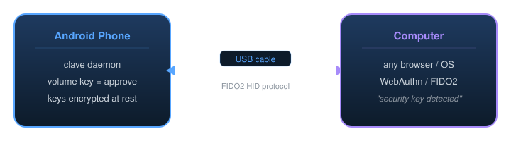

<p align="center">
  
</p>

<h1 align="center">clave</h1>

<p align="center">
  Your old Android phone is a FIDO2 security key. Plug it in.
</p>

<p align="center">
  <a href="https://golang.org"></a>
  <a href="LICENSE"></a>
  <a href="#"></a>
  <a href="#"></a>
  <a href="#"></a>
</p>

---

Clave is a single Go binary. It runs on a rooted Android phone, creates a standard USB HID device, and speaks CTAP2. Your computer sees a hardware security key. No dongle. No Bluetooth. No cloud relay. One USB cable.

Works everywhere hardware keys work: GitHub, Google, OpenAI, Cloudflare, Bitwarden, and every other site that speaks WebAuthn.

## How it works

<p align="center">
  
</p>

1. A Magisk module registers a USB HID gadget through ConfigFS after boot completes, with the FIDO Alliance descriptor (`0xF1D0`)
2. The host OS recognizes it as a standard FIDO2 authenticator — no drivers needed
3. When a site requests WebAuthn, the CTAP2 protocol runs over USB HID packets
4. You press Volume Down on the phone to approve. Private keys never leave the device.

## Features

**Protocol**
- CTAP2 with FIDO_2_0 and FIDO_2_1_PRE
- ES256 (ECDSA P-256) with low-S normalization
- Packed self-attestation
- Resident/discoverable credentials
- User presence + user verification via hardware button
- CTAPHID keepalive during user interaction

**Security**
- AES-256-GCM encryption for credential storage
- PBKDF2-HMAC-SHA256 key derivation (100,000 iterations)
- Per-credential ECDSA key generation
- Backup and restore with encrypted exports

**Engineering**
- Single static binary, zero external dependencies
- ~1,200 lines of Go
- Runs alongside ADB (composite gadget) or standalone
- Custom CBOR encoder with canonical key ordering
- Works on any phone with `CONFIG_USB_CONFIGFS_F_HID=y`

## Requirements

| What | Details |
|---|---|
| Phone | Any rooted Android with Magisk |
| ROM | Custom ROM with USB ConfigFS HID support — LineageOS 20+ works |
| Computer | macOS, Linux, or Windows with `adb` installed |
| Cable | USB-C or micro-USB, data-capable |

**Tested on:** Xiaomi Redmi 9 (lancelot, MT6768), LineageOS 24.0, kernel 4.19

## Install

**Step 1 — Push binary:**

```bash
curl -sL https://github.com/thekeenest/clave/releases/latest/download/clave-arm64 -o clave
adb root
adb push clave /data/local/tmp/clave
adb shell chmod 755 /data/local/tmp/clave
```

**Step 2 — Install Magisk module** (sets up USB HID at boot):

```bash
adb push build/clave-hid.zip /data/local/tmp/
adb shell magisk --install-module /data/local/tmp/clave-hid.zip
adb push magisk/clave-hid/service.sh /data/adb/modules/clave-hid/
adb shell chmod 755 /data/adb/modules/clave-hid/service.sh
adb reboot
```

**Step 3 — Run:**

```bash
adb shell /data/local/tmp/clave serve -password YOUR_PASSWORD
```

Plug USB into your computer. Open any WebAuthn site. Click "Add security key." Press Volume Down on the phone. Done.

**Build from source:**

```bash
git clone https://github.com/thekeenest/clave.git && cd clave
CGO_ENABLED=0 GOOS=linux GOARCH=arm64 go build -o build/clave .
adb push build/clave /data/local/tmp/clave
```

**Control script** (for daily use):

```bash
bash scripts/clavectl.sh start           # start security key mode
bash scripts/clavectl.sh start --auto-approve  # skip button press (testing only)
bash scripts/clavectl.sh stop            # stop daemon
```

## Usage

```bash
# Credential management
bash scripts/clavectl.sh list            # list stored credentials
bash scripts/clavectl.sh backup          # download encrypted backup
bash scripts/clavectl.sh restore FILE    # restore from backup

# Diagnostics
bash scripts/clavectl.sh status          # daemon + HID gadget status
bash scripts/clavectl.sh logf            # follow daemon log
bash scripts/clavectl.sh check           # verify kernel HID support

# Cleanup
bash scripts/clavectl.sh teardown        # remove HID, restore normal USB
```

## Architecture

```
clave/
├── main.go          Entry point — CLI routing (serve, setup, list, backup)
├── ctap2.go         CTAP2 commands — makeCredential, getAssertion, getInfo
├── ctaphid.go       HID transport — packet framing, keepalives, channel mgmt
├── cbor.go          CBOR codec — canonical map ordering per CTAP2 spec
├── gadget.go        USB ConfigFS — HID gadget create/bind/teardown
├── store.go         Key store — AES-256-GCM encrypted credential file
├── presence.go      User presence — Linux input subsystem (volume keys)
├── magisk/
│   └── clave-hid/          Magisk module — sets up USB HID after boot completes
│       ├── module.prop
│       └── service.sh
├── scripts/
│   ├── clavectl.sh         Host-side control script
│   └── standalone-fido.sh  Standalone mode (no ADB, pure FIDO2)
└── test/
    └── webauthn-test.html  Browser test page
```

## Comparison

| | **clave** | YubiKey 5 | fidont | Phone passkeys |
|---|---|---|---|---|
| Extra hardware needed | No | $50+ per key | ESP32 dongle | No |
| Connection | Direct USB | USB / NFC / BLE | USB / BLE / QR / NFC | BLE / QR |
| Setup time | 5 minutes | Unbox it | Android app + flash dongle | Built in |
| Key storage | AES-256-GCM file | Secure element | TEE / StrongBox | TEE / StrongBox |
| Works fully offline | Yes | Yes | Partial (relay for QR) | No |
| Root required | Yes | No | No | No |
| FIDO certified | No | Yes | No | Varies |
| Codebase | ~1,200 lines Go | Proprietary | Multi-component | OS vendor |
| Dependencies | Zero | N/A | Kotlin + ESP-IDF + Rust + Go | N/A |

**The trade-off:** root is required, keys live in software not a secure element. In return you get a working USB security key from a phone that was collecting dust.

## Browser support

| Browser | macOS | Linux | Windows |
|---|---|---|---|
| Safari | ✅ | — | — |
| Chrome | ✅ | ✅ | untested |
| Firefox | ✅ | ✅ | untested |
| Edge | — | — | untested |

## Security model

Clave generates an ECDSA P-256 key pair for each credential. Private keys are serialized to JSON and encrypted with AES-256-GCM. The encryption key is derived from your password via PBKDF2-HMAC-SHA256 with 100,000 iterations.

Every sign or register operation requires a physical button press (Volume Down) on the phone. In auto-approve mode this check is skipped — use it only for testing.

**Honest limitations:**
- Software key storage, not a secure element. An attacker with root on the running phone can extract keys.
- The password guards against offline/cold attacks on the encrypted file. It doesn't help if the device is compromised while the daemon runs.
- Not FIDO Alliance certified. Some sites that mandate certification will reject it.
- Single-device — if you lose the phone and have no backup, those credentials are gone.

If you need tamper-resistant hardware, buy a YubiKey. Clave is for people who want real WebAuthn from a device they already own.

## Roadmap

- [ ] CTAP 2.1 (PIN protocol, credential management)
- [ ] hmac-secret extension (for disk encryption tools)
- [ ] Android app with toggle UI
- [ ] NFC transport
- [ ] FIDO2 conformance test suite
- [ ] Windows + ChromeOS testing

## Contributing

The whole thing is ~1,200 lines of Go with no external packages. Read `ctap2.go` first — that's where the protocol lives. PRs welcome.

```bash
# Run tests
go test ./...

# Build and deploy
bash scripts/clavectl.sh deploy

# Check kernel support on a new device
bash scripts/clavectl.sh check
```

## License

[MIT](LICENSE)

---

<p align="center">
  Built by <a href="https://github.com/thekeenest">@thekeenest</a>
</p>
